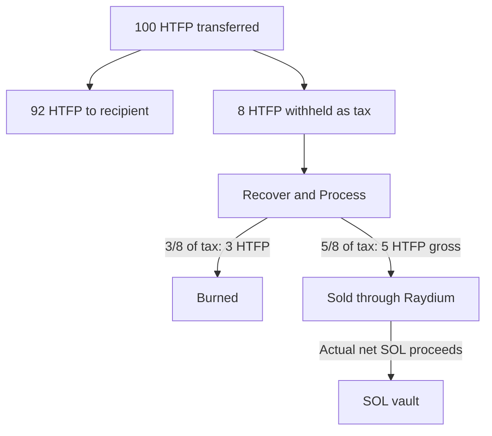
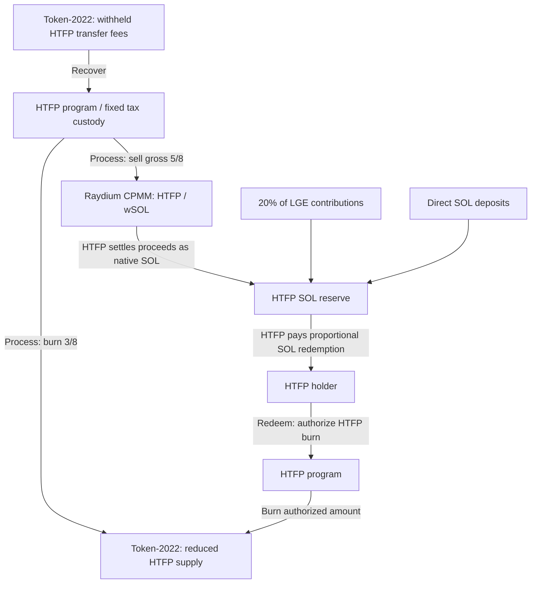

# HTFP — Hold The Fucking Position

**HTFP is designed as a SOL-backed token with on-chain redemption through its vault.** Once the protocol is initialized and funded, holders can burn HTFP to redeem a proportional share of the vault's spendable SOL under the redemption rules below. This redemption value depends on the actual SOL available and total token supply before the burn, rather than a fixed SOL price.

**Testnet pilot deployed.** The limited token/vault pilot supports initialization, tax recovery and holder redemption. Positive 8% fee tests await activation at epoch 1086; tax-to-SOL processing and final Raydium liquidity integration remain under development. The architecture below describes the full intended protocol.

Testnet: [HTFP program](https://explorer.solana.com/address/CseQKCWvi4EA2o3oa11Age4p4xKWSLuzjWCzitASrPJu?cluster=testnet) · [HTFP mint](https://explorer.solana.com/address/rRPZUSGGDPsHKKt1zP4ZLfviW9sVZ2FYKcDgdc4j55o?cluster=testnet). The [deployed pilot source](programs/htfp-testnet/) is distinct from the full processing candidate. Program upgrades and metadata remain controlled by the approved Testnet wallet during trials.

## How the 8% tax works

Example: **100 HTFP transferred after the 8% fee becomes active**.

The initial 8% tax is split into a nominal **3% of the transferred HTFP burned** and **5% offered for sale to fund the vault**. The split takes place when collected taxes are recovered and successfully processed.

The sale transfer is also taxed: 5 HTFP gross gives 4.6 HTFP net input and 0.4 HTFP withheld for later recovery, before Raydium fees. Native integer rounding applies. These are HTFP amounts; the SOL credited to the vault depends on actual swap execution.

## Programs and their roles

| Program | Role in HTFP |
| --- | --- |
| **[HTFP](programs/htfp-both/)** | The project's Rust program: initialization, tax recovery, burn/swap processing and holder redemption. |
| **Token-2022** | Manages the HTFP mint, token balances, native transfer fees and token burns. |
| **Raydium CPMM** | Provides the intended HTFP / SOL-wSOL pool and executes swaps. |
| **Raydium Burn & Earn** | Intended locking mechanism for initial LP tokens, with fee rights retained through the Fee Key. |
| **System and SPL Token** | Handle native SOL transfers and internal wSOL settlement. |

HTFP integrates with these existing Solana programs. The mint, tax custody, SOL reserve and pool vaults are accounts that hold assets or state.

## How they interact

**Tax recovery and processing.** Anyone can call the recovery and processing operations with valid inputs. Recovered taxes enter fixed HTFP custody. Processing burns **3/8** and sells the remaining **gross 5/8** through the fixed pool; the sale transfer remains subject to the HTFP tax. Actual native SOL proceeds go to the fixed reserve. Callers cannot redirect the recovered taxes or swap proceeds. Burn, sale and settlement are designed to complete atomically.

## The SOL vault

The vault is the protocol's native SOL reserve. It receives:

- **20% of LGE contributions** as initial backing.
- **Actual SOL proceeds from processing taxes:** 3/8 of recovered HTFP is burned; the gross 5/8 is sold through Raydium, and the resulting SOL goes into the vault after applicable fees.
- **Direct SOL deposits**, which also become backing while HTFP supply is positive.

Taxable trading and transfers generate HTFP fees. Those fees must be recovered and successfully processed before they add SOL to the vault; trading volume alone does not automatically credit it. The 5/8 fraction describes a token amount, not a guaranteed SOL return. Creator and Burn & Earn income goes to the founder wallet as described below.

### Pool trading and vault redemption

Holders have two intended routes:

- **Trade through Raydium:** buy or sell HTFP at the pool's market price after trading opens, subject to liquidity, pool status and applicable fees.
- **Redeem through the vault:** authorize a full burn of A HTFP base units and receive `floor(V × A / S)` lamports, where V is spendable vault SOL in lamports and S is pre-burn supply in token base units. This route is independent of pool trading and requires valid authorization, positive supply, a positive payout and satisfaction of the holder's minimum.

### How activity strengthens backing

Successful tax processing adds SOL to the vault while reducing HTFP supply through the 3/8 burn. With positive remaining supply, this increases **SOL backing per remaining HTFP**: more SOL backs a smaller token supply. Redemptions pay SOL out and burn the authorized HTFP, reducing both reserve and supply proportionally, subject to integer rounding.

The Raydium market price can rise or fall. Selling the 5/8 portion into the pool adds HTFP and removes SOL, which creates downward price pressure. Growing vault backing does not guarantee a continuously rising pool price. This distinction follows from [Raydium's constant-product swap calculation](https://github.com/raydium-io/raydium-cp-swap/blob/master/programs/cp-swap/src/curve/constant_product.rs).

## Token and launch design

| Item | Intended design |
| --- | --- |
| Supply | 1,000,000,000,000 HTFP; 7 decimals; no later issuance |
| Transfer fee | 8%, without an economic cap; native integer rounding applies |
| Activation | Initial 0% phase, then 8% at the fee-update epoch E + 2 |
| Token allocation | 55% participants / 35% pool / 5% team / 5% separate marketing wallet |
| Contributed SOL | 80% pool / 20% HTFP reserve |
| Raydium fee target | 0.25% ordinary + 0.05% creator, in BothToken mode |

The LGE is handled manually: SOL contributors receive their share of the participant allocation in proportion to contributed SOL. Initial distribution and pool funding take place during the 0% phase; trading is intended to open by timestamp after fee activation plus an additional margin.

The intended liquidity arrangement places **100% of initially received LP tokens into official Burn & Earn**. Creator income and Burn & Earn income go to the same founder wallet, with applicable HTFP transfer fees. This LP mechanism is separate from the HTFP burns shown above.

## Source

The [Rust source](programs/htfp-both/) contains the current HTFP development candidate. See the [program directory](programs/README.md) for its scope and external dependencies.

No project-wide license has been selected. Dependencies retain their own terms; see [third-party notices](THIRD_PARTY_NOTICES.md).
