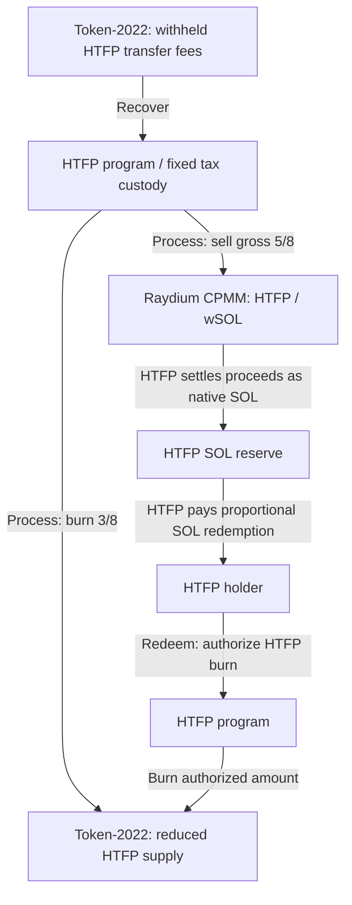

# HTFP — Hold The Fucking Position

HTFP is a Solana Token-2022 project that connects transfer fees, token burns and a native SOL reserve. Holders can burn HTFP to redeem a proportional share of the reserve.

**Under development.** This page describes the intended architecture. Public deployment and final liquidity integration remain pending.

## Programs and their roles

| Program | Role in HTFP |
| --- | --- |
| **[HTFP](programs/htfp-both/)** | The project's Rust program: initialization, tax recovery, burn/swap processing and holder redemption. |
| **Token-2022** | Manages the HTFP mint, token balances, native transfer fees and token burns. |
| **Raydium CPMM** | Provides the intended HTFP / SOL-wSOL pool and executes swaps. |
| **Raydium Burn & Earn** | Intended locking mechanism for initial LP tokens, with fee rights retained through the Fee Key. |
| **System and SPL Token** | Handle native SOL transfers and internal wSOL settlement. |

HTFP integrates with these existing Solana programs. The mint, tax custody, SOL reserve and pool vaults are accounts that hold assets or state.

## How they interact

**Tax recovery and processing.** Anyone can call the recovery and processing operations with valid inputs. Recovered taxes enter fixed HTFP custody. Processing burns **3/8** and sells the remaining **gross 5/8** through the fixed pool; the sale transfer remains subject to the HTFP tax. Actual native SOL proceeds go to the fixed reserve. Callers cannot redirect the recovered taxes or swap proceeds. Burn, sale and settlement are designed to complete atomically.

**Holder redemption.** A holder authorizes a burn of their HTFP and receives `floor(V × A / S)` lamports: V is spendable reserve SOL in lamports, A is the authorized amount in token base units, and S is supply before the burn. Redemption burns the full authorized amount and works independently of the pool. Its value changes with reserve balance and token supply.

## Token and launch design

| Item | Intended design |
| --- | --- |
| Supply | 1,000,000,000,000 HTFP; 7 decimals; no later issuance |
| Transfer fee | 8%, without an economic cap; native integer rounding applies |
| Activation | Initial 0% phase, then 8% at the fee-update epoch E + 2 |
| Token allocation | 55% participants / 35% pool / 5% team / 5% separate marketing wallet |
| Contributed SOL | 80% pool / 20% HTFP reserve |
| Raydium fee target | 0.25% ordinary + 0.05% creator, in BothToken mode |

The LGE is handled manually: SOL contributors receive their share of the participant allocation in proportion to contributed SOL. Initial distribution and pool funding take place during the 0% phase; trading is intended to open by timestamp after fee activation plus an additional margin.

The intended liquidity arrangement places **100% of initially received LP tokens into official Burn & Earn**. Creator income and Burn & Earn income go to the same founder wallet, with applicable HTFP transfer fees. This LP mechanism is separate from the HTFP burns shown above.

## Source

The [Rust source](programs/htfp-both/) contains the current HTFP development candidate. See the [program directory](programs/README.md) for its scope and external dependencies.

No project-wide license has been selected. Dependencies retain their own terms; see [third-party notices](THIRD_PARTY_NOTICES.md).
